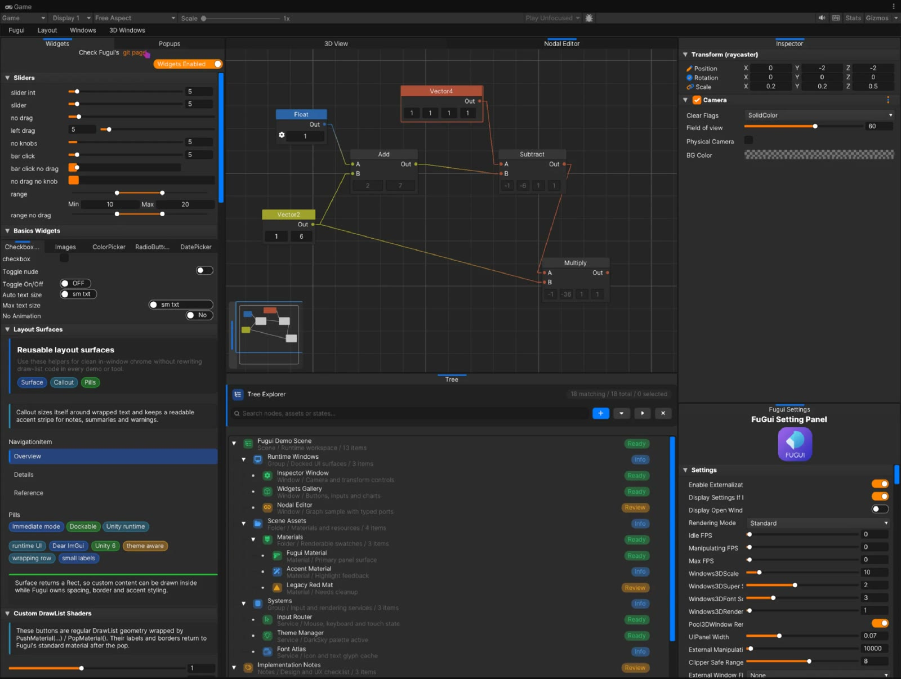
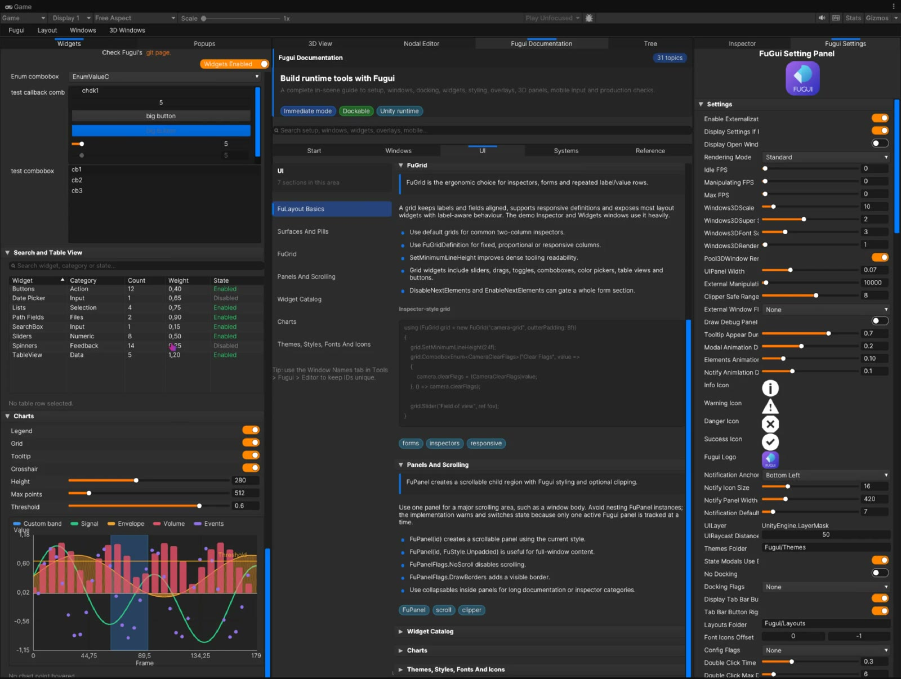
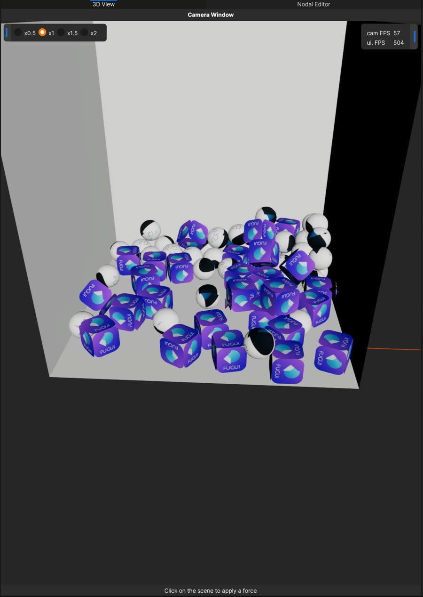
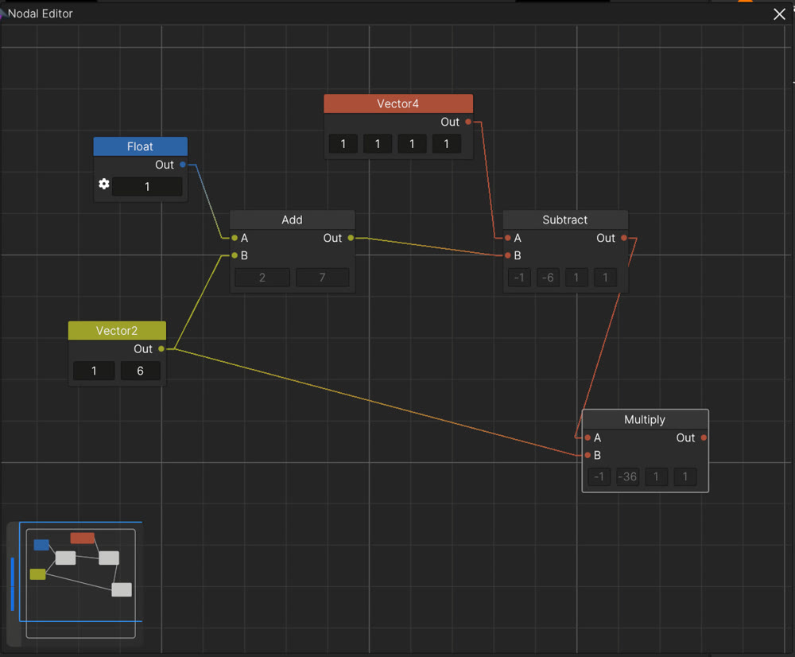
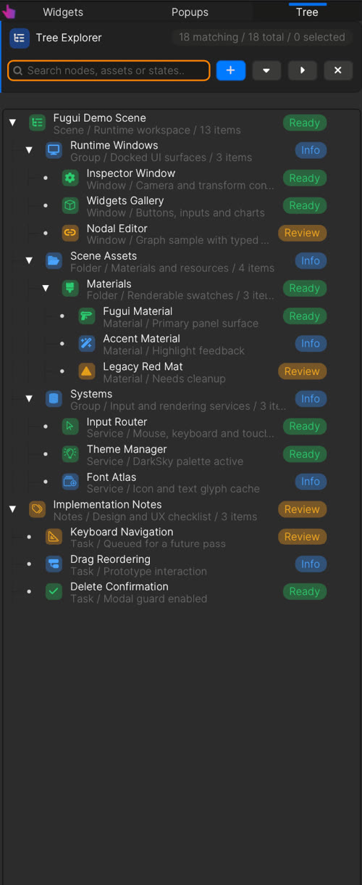
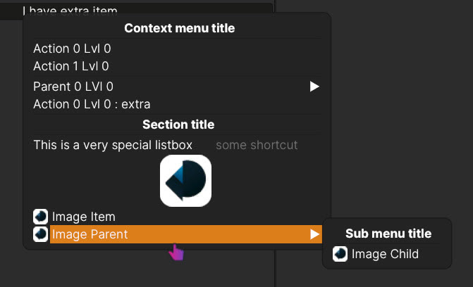
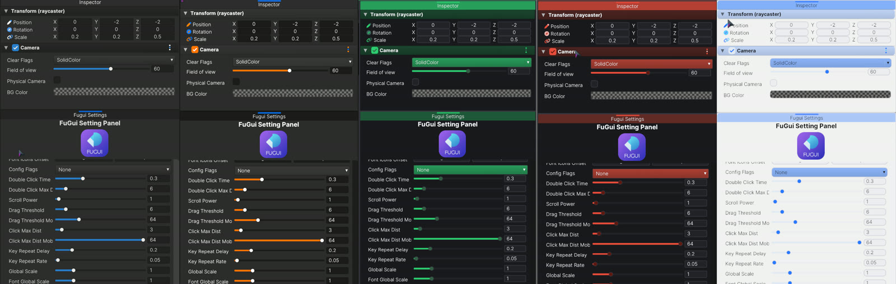

<p align="center">
  
</p>

<h1 align="center">Fugui</h1>

<p align="center">
  <b>A production-grade Dear ImGui framework for Unity 6.</b><br>
  Dockable tools, camera views, 3D/VR panels and mobile apps, drawn by Dear ImGui and rendered natively in URP.
</p>

<p align="center">
  
  
  
  
</p>

<p align="center">
  
</p>

Fugui is not a debug overlay. It uses [Dear ImGui](https://github.com/ocornut/imgui) as a low-level drawing and layout engine, and builds on top of it everything you need to ship **real software** inside Unity: docking with saved layouts, multi-instance windows, camera views, world-space and VR panels, windows you can drag out to another monitor, themes, high-level widgets, a nodal editor, touch input for mobile, and tight control over how often each piece of UI is redrawn.

It has been in production for years: it is the interface of **Dragonfly**, the real-time 3D viewer used at **Airbus Defence and Space** for satellite, aircraft and helicopter projects, and of every application I build.

---

## Why Fugui

Dear ImGui is the best way to write tools fast. Bringing it into Unity for a product, not just for debug, raises questions the existing bindings don't answer: how do you dock and restore layouts, render into a camera view or a VR panel, run on a phone, theme it like a real product, and keep the UI from eating the frame budget of a heavy 3D scene?

Fugui answers them in one package:

- **Software first, games welcome.** Designed for 3D tools, viewers, editors and dashboards. Also used for full game UIs.
- **You pay only for what you see.** Each window has its own redraw rate. Static UI can be frozen and replayed from cached draw commands. Hidden parts cost nothing.
- **Unity-native rendering.** Draw lists go straight through a URP `ScriptableRendererFeature` (RenderGraph, Unity 6), with optional custom materials per draw command.
- **Easy to write, easy to maintain.** Immediate-mode code, plus `FuLayout` and `FuGrid` for clean, responsive inspectors and forms in a few lines.
- **Made to be customized.** Full theme system, multiple fonts, icon fonts, custom headers, custom shaders.

## What you get

### Windows, docking and layouts
- Dockable, closable, multi-instance windows declared once with `FuWindowDefinition`.
- Custom docking system with tabs and groups; layouts saved to files and edited from a Unity editor tool.
- **Externalized windows**: drag a window out of the app and it becomes a real OS window on another screen (SDL2 / OpenGL).
- Overlays anchored inside windows, custom window headers and footers, modal dialogs, notifications, multi-level context menus.

<p align="center">
  
</p>

### Camera views and 3D / VR panels
- **Camera windows**: any Unity camera rendered inside a Fugui window, with supersampling, MSAA, its own FPS and raycasting from the view.
- **3D windows**: Fugui windows placed in the scene as world-space panels, optionally curved, movable and resizable at runtime, interactive with a raycaster, usable in VR.
- **World surfaces**: draw Fugui draw lists directly in world space for labels, markers and diegetic panels, without a full window.

<p align="center">
  
  &nbsp;
  
</p>

### Widgets
- Text with smart formatting, buttons and button groups, checkboxes, toggles, radio buttons, sliders, ranges, drags, knobs, combo boxes, list boxes, tabs.
- Color picker, gradient editor, images, video player, date and time pickers, file and folder fields with native dialogs, progress bars and loaders.
- **Search box and sortable, filterable table view.**
- **Charts**: lines, bars, points, custom series, hover state, thousands of points.
- **Tree explorer** with icons, states, search and selection.
- **Nodal editor**: typed ports, graph registry, minimap, clipboard, JSON serialization.
- **`FuGrid` and `FuLayout`**: aligned label/value rows, fixed, proportional or responsive columns. This is what makes inspectors pleasant to write.

<p align="center">
  
  &nbsp;
  
</p>

### Themes and fonts
- Complete themes switchable at runtime, a theme editor, and your own colors added to the theme system.
- Several fonts and sizes at once, icon fonts (regular and duotone), hot reload of the font atlas, baked atlases for fast startup.

<p align="center">
  
</p>

### Performance
- **Per-window frame rate**: idle FPS, manipulation FPS and a global max FPS. A window that doesn't change doesn't redraw.
- **Frozen UI**: any static block can be captured after a few frames and replayed from its cached draw commands.
- **Draw-list-only mode** and reduced per-frame allocations in the render path; optimized unsafe code for font glyphs.
- **Baked and shared font atlases**, pooled resources for 3D windows.
- In the demo scene above, the UI renders at **500+ FPS** while the 3D camera view runs at its own pace.

### Platforms and input
- Windows (x86, x64, ARM64), macOS, Linux, **Android and iOS**.
- Touch-first input on mobile: scrolling, drag thresholds, larger hit areas. A mobile demo app is included.
- Keyboard, mouse, raycast and touch input handled per context and per window; Unity Input Manager or Input System.

### Editor tooling
- Setup wizard that checks and fixes your project (controller, URP feature, assets, fonts).
- Editors for docking layouts and window names, font atlas baking, real-time window preview.

## Used in production

| Project | What it is |
|---|---|
| **Dragonfly**, Airbus Defence and Space | Real-time 3D viewer for satellites, aircraft and helicopters: heavy CAD models, exploded views, cuts, measurements, annotations, VR, remote control API. The whole interface is Fugui. |
| **VR cockpit flight simulator** | Flight training in VR, seated inside the cockpit. Fugui drives both the flat 2D interface and the in-cockpit 3D/VR interfaces, on Windows, macOS, Android and Meta Quest standalone. |
| **Aircraft configurator back-office** | The production tool behind a web aircraft and livery configurator: database binding, content generation and configuration. |
| **Slyvek** | A tactical MMORPG. Its full game interface is built with Fugui. |
| **Dodge From Light** | An online multiplayer speed game with a collaborative level editor. |

Fugui is the UI layer of every application built at [VRDTM Studio](https://vrdtmstudio.com).

## Quick start

```csharp
using Fu;
using Fu.Framework;

public class InspectorWindow : FuWindowBehaviour
{
    private bool _enabled = true;
    private float _intensity = 0.5f;
    private Color _tint = Color.white;

    public override void OnUI(FuWindow window)
    {
        using (var grid = new FuGrid("inspector"))
        {
            grid.Toggle("Enabled", ref _enabled);
            grid.Slider("Intensity", ref _intensity, 0f, 1f);
            grid.ColorPicker("Tint", ref _tint);
        }

        if (Fugui.Layout.Button("Save"))
            Fugui.Notify("Saved", "Settings saved", StateType.Success);
    }
}
```

Add the component to a GameObject, pick its window name in the inspector, press Play: the window is created, docked according to your layout, themed, and only redrawn when needed.

## Installation

1. In Unity 6 (URP), open **Window > Package Manager > + > Add package from git URL** and paste:
   `https://github.com/Keksls/fugui.git`
2. Open **Tools > Fugui > Editor > Setup** and apply the suggested fixes. It adds the controller, installs the URP render feature and copies the runtime assets.
3. Import the **Fugui Demo Scene** sample from the Package Manager to see everything above running.

Dear ImGui is used through [ImGui.NET](https://github.com/ImGuiNET/ImGui.NET) and cimgui native libraries, shipped for every supported platform. ImPlot, ImNodes and ImGuizmo bindings are included.

## Documentation

- **Full guide** (setup, windows, camera and 3D windows, world surfaces, docking, themes, widgets, popups, externalization, mobile): [Documentation~/Guide_FR.md](Documentation~/Guide_FR.md) (in French, English version in progress).
- **Technical documentation**: [TECHNICAL_DOCUMENTATION.md](TECHNICAL_DOCUMENTATION.md).

## License and contributing

Fugui is free and open source under the [MIT License](LICENSE).
Contributions are welcome through pull requests, reviewed and merged by the maintainer: see [CONTRIBUTING.md](CONTRIBUTING.md).

## Credits

Fugui is built on [Dear ImGui](https://github.com/ocornut/imgui) by Omar Cornut and contributors, through [ImGui.NET](https://github.com/ImGuiNET/ImGui.NET) and [cimgui](https://github.com/cimgui/cimgui).

Created and maintained by Kévin Bouetard ([VRDTM Studio](https://vrdtmstudio.com)), Unity / C# developer and former lead developer of Dragonfly.
